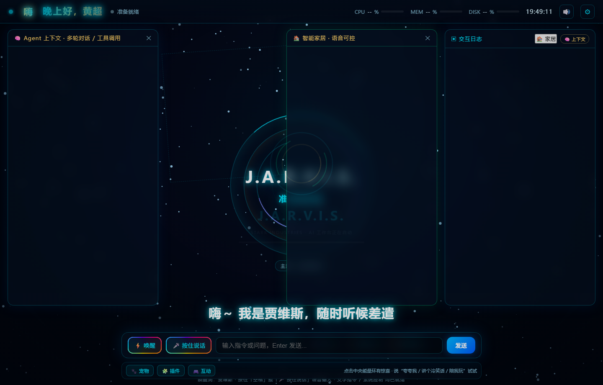
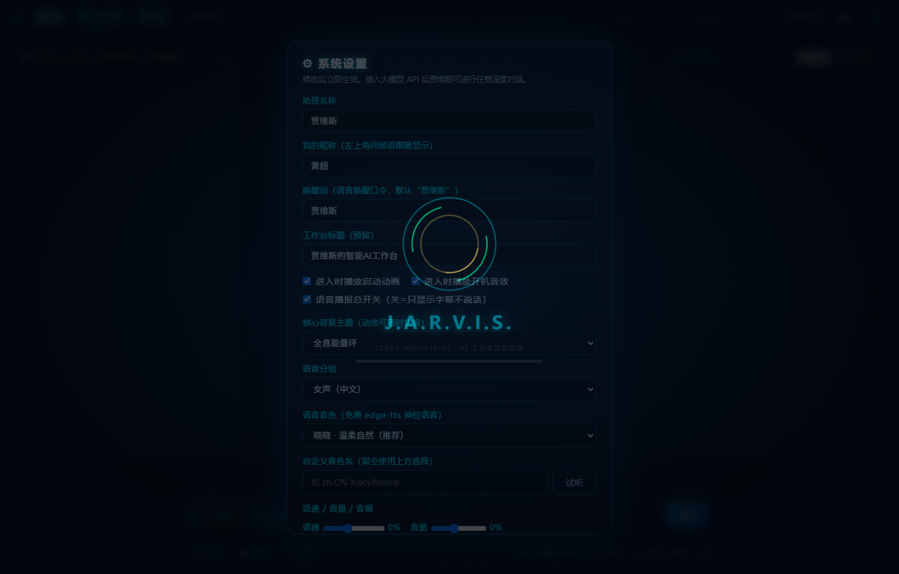

# J.A.R.V.I.S. 桌面智能助理


托尼・斯塔克同款桌面语音助理：**语音对话 + 免费神经语音回复 + 实时字幕 + 酷炫全息界面 + 系统级命令执行**。

## 快速开始


1. 双击 `start_jarvis.bat`（自动检查 / 安装依赖，启动服务并打开界面）。

2. 首次打开界面，浏览器会请求麦克风权限，请允许（用于语音输入）。

3. 开始使用：

* **文字**：底部输入框输入指令，回车发送；

* **语音**：点击「⚡ 唤醒」开启连续聆听，说 **“贾维斯”** 唤醒后再下达指令；或**按住空格键** / 按住「🎤 按住说话」直接说。

> 语音识别与语音合成均使用
> **免费方案**
> ：浏览器 Web Speech API（识别）+ Microsoft edge-tts 神经语音（合成，无需任何 Key）。没有网络时自动降级为浏览器本地语音朗读。

## 系统权限说明


* 贾维斯在本机**当前用户权限**下执行命令（打开应用、控制音量、锁屏、截图、查看磁盘等）。

* **关机 / 重启 / 退出助理**等高风险操作会在界面弹窗**二次确认**后才执行。

* 若需要管理员级操作，可右键 `start_jarvis.bat` → “以管理员身份运行”，服务即获得管理员权限。

## 支持的功能


| 分类         | 指令示例                                                           |
| ---------- | -------------------------------------------------------------- |
| 语音 / 文字对话  | “你好” “现在几点” “今天星期几”                                            |
| 应用控制       | “打开记事本 / 计算器 / 微信 / Chrome” “关闭记事本”                            |
| 网页 / 搜索    | “打开 [bilibili.com](https://bilibili.com)” “搜索 Python 教程”       |
| 系统控制       | “调大音量” “音量调到 30” “静音” “锁屏” “睡眠” “截图”                           |
| 信息查询       | “深圳明天天气” “北京天气” “今天有什么新闻” “系统状态” “磁盘空间”                        |
| 计算         | “计算 3.14\*8” “2 的 10 次方”                                       |
| 办公备忘       | “记下买牛奶” “查看备忘”                                                 |
| 定时提醒       | “提醒我 30 分钟后喝水” “明天 9 点提醒我开会” “查看提醒”                            |
| 剪贴板        | “剪贴板有什么” “复制 这段内容”                                             |
| 文件目录       | “打开下载文件夹” “打开 D:/ 工作”                                          |
| 知识问答       | “太阳系有几大行星” “圆周率是多少”                                            |
| 趣味         | “讲个笑话” “给我一句名言”                                                |
| 智能家居       | “打开客厅灯” “空调调到 24 度” “关窗帘” “扫地机器人开始工作”；左侧「🏠 家居」面板可视化直控（开关 / 亮度 / 温度滑块），可选接入 Home Assistant 真实设备 |
| Agent 深度对话 | 接入任意厂商大模型后：多轮上下文 + 自动调用工具（天气 / 新闻 / 计算 / 系统状态 / 备忘 / 搜索）+ 流式输出 |

## 接入 AI 大脑（Agent 模式，可选但推荐）

点击右上角 **⚙ 设置** → 服务厂商下拉一键切换 **52 家厂商**（订阅 / 供应商 / 中转三组，与 magpie 最新列表同步，含 DeepSeek、OpenAI、Gemini、Claude、Kimi、智谱、混元、豆包、千问、OpenRouter、硅基流动等）：

1. 选择厂商（自动填入默认地址与推荐模型）→ 填入 **API Key** → 勾选 **启用 AI 大脑** → **保存**；
2. 支持**「⚡ 检测连接」**：一键验证当前 Key 是否可用并返回可用模型名，无需等对话才发现；
3. 各厂商 Key 独立保存，切换厂商无需重输；Key 在设置中**不回填明文**（留空保存=保持原值），杜绝误清空；
4. 启用后进入 **Agent 模式**：多轮上下文记忆 + 自动调用工具（天气 / 新闻 / 计算 / 系统状态 / 备忘 / 搜索）+ **流式逐字输出**，工具调用过程在「🧠 上下文」面板可见（类 DeepSeek Harness Web 体验）。

未配置 Key 时使用 **本地意图引擎 + 维基百科 + 网页搜索** 兜底，开箱即用。

## 界面说明


* **中央全息核心**：**系统状态**（慢速光环）/ 倾听中（加速）/ 思考（金色）/ 播报（波动条动画）；4 套动效主题可切换（全息能量环 / 粒子漩涡 / 线框能量球 / 极光脉冲）；

* **底部大字幕**：实时显示贾维斯说的话（逐字输出，与语音同步）；

* **右侧日志面板**：完整交互记录；顶部实时显示 CPU / 内存 / 磁盘占用；

* **🧠 上下文面板**：Agent 模式下的多轮对话记录与工具调用过程（⚙ 工具名 + 结果），点击日志面板右上角「🧠 上下文」展开；

* **常用指令快捷芯片**：底部「🎲 换一批」动态提示词 —— 每次进入 / 每次对话 / 点击换一批都会**随机轮换**，内容结合**当前热点新闻**（科技 / 财经）、**你的所在城市与会话记录**（聊过天气就推天气、聊过备忘就推备忘）、智能家居玩法与 **60+ 条趣味大数据话题池**（冷笑话 / 冷知识 / 今日名言 / 深圳房价分析 / AI 新品速递 / 模拟面试 / 通勤避堵……），服务端每次随机抽取 12 条、界面随机展示 5 条，趣味性与随机度拉满。

* **停止 / 发送**：Agent 流式生成时发送按钮变为红色「⏹ 停止」，点击即中断生成并停止语音播报。

* **空格键按住说话**：按住空格开始语音识别、松开自动发送（输入框打字不受影响）。

* **推理强度**：设置 → 推理强度（低 / 中 / 高），高挡深度思考更严谨，低挡响应更快。

* **🎨 彩虹跑马灯输入区**：输入框与「发送 / 唤醒 / 按住说话」按钮全部套上**七彩色不断循环绕圈**的流光边框（旋转彩虹层实现，全浏览器兼容、肉眼可见持续绕圈），停止按钮保持红色警示。

* **左上角随机打招呼**：不再固定品牌名，改为「HI / Hello / 嗨 / 哈喽 / 你好呀 / YO!…」**随机轮换** + 按当前时段大字体问候（早上好 / 上午好 / 下午好 / 晚上好，+ 你的昵称），昵称在设置中自定义（默认“黄超”）。

* **可自定义唤醒词**：设置 → 唤醒词（默认“贾维斯”），可改为任意口令（如“电脑管家”“嗨小爱”），语音唤醒与底部提示同步生效。

* **双面板默认展开**：左侧「🧠 Agent 上下文」与右侧「🏠 智能家居」**默认同时展开**，各自支持一键收起 / 展开（面板头部 ✕ 与日志栏「🏠 家居」「🧠 上下文」按钮）。

* **说话放大闪烁**：倾听 / 播报时中央能量环**持续放大呼吸 + 灯光快速闪烁**，麦克风波形条始终跳动，语音输入实时反馈。

* **启动动画与音效可自定义**：设置 → 「进入时播放启动动画 / 播放开机音效」两个开关，关闭后快速进入界面。

* **🐾 桌面宠物养成**（v2.0）：底部「宠物」面板 —— 4 款宠物（猫 / 柯基 / 机器人 / 小龙）可选，喂食 / 抚摸 / 陪玩互动，饱食度与心情值实时变化并持久化，宠物会随状态语音 / 字幕回应。

* **🧩 插件中心**（v2.0）：底部「插件」面板 —— 7 个内置插件（天气 / 新闻 / 系统监控 / 智能家居 / 备忘 / 冷笑话 / 每日一言）一键运行，支持**自定义插件**（名称 + 触发指令，保存后一键运行或删除）。

* **🎮 互动玩法**（v2.0）：底部「互动」面板 —— 点击中央星环随机彩蛋、说「夸夸我 / 讲个冷笑话 / 陪我玩 / 抛硬币 / 摇骰子 / 我爱你 / 你好棒 / 我好难过」触发对应趣味回应（抛硬币、骰子、石头剪刀布、情感夸赞安抚等）。

* **🔇 语音播报总开关**（v2.0）：设置 → 「语音播报总开关」—— 关闭后贾维斯**只显示字幕不说话**（语音识别仍可用），适合静音办公场景。

* **⚡ 检测连接**（v2.0）：设置 → API Key 输入框旁「检测连接」按钮，一键验证 Key 是否可用并返回可用模型名与错误信息。

## 界面预览（Screenshots）

| v2.0 主界面 · 随机打招呼 + 系统状态 + 宠物/插件/互动玩法 | v2.0 设置面板 · 语音总开关 + API Key 检测连接 |
| --- | --- |
|  |  |

## 智能家居玩法（🏠 家居）


* **开箱即用**：内置 8 个本地模拟设备（客厅灯 / 卧室灯 / 空调 / 窗帘 / 电视 / 风扇 / 加湿器 / 扫地机器人），状态持久化，**语音 / 文字指令**直接控制并**语音回复**结果——“打开客厅灯”“空调调到 24 度”“关窗帘”“客厅灯开着吗”；
* **可视化面板**：日志面板右上角「🏠 家居」展开设备卡，开关一键切换、空调温度 / 灯光亮度滑块实时直控，语音指令与面板操作**双向同步**（任何一端操作，所有端即时刷新）；
* **接入真实设备（可选）**：设置 → 智能家居 → 填写 Home Assistant 地址与长期访问令牌，指令自动转发到 HA REST API（灯光 / 空调 / 电视 / 风扇），失败自动回落本地模拟。

## 语音定制（设置 → 语音）


* **39 个免费神经音色**，分 **女声（中文）14 / 男声（中文）9 / 英文 8 / 多语言 8** 四组，也可直接填写任意音色名（如 `zh-CN-XiaoyiNeural`）；

* **语速 / 音量 / 音调**三滑块实时调节，一键「试听」立即预览效果。

## 技术架构


```
浏览器界面 (全息 UI + 字幕 + 流式输出 + Web Speech 语音识别)
        │  WebSocket (实时消息) / HTTP (音频、页面)
Python 服务 (aiohttp)
        ├─ 大脑 Brain：意图识别 → 命令路由 / Agent（多厂商 LLM + 工具调用 + 多轮上下文 + 流式）
        ├─ 命令引擎 commands：PowerShell 系统控制
        ├─ 语音合成 tts_engine：edge-tts 免费神经语音 (MP3，39 音色 + 语速/音量/音调)
        ├─ 智能家居 smart_home：本地设备中枢 + Home Assistant REST 桥接
        ├─ 信息服务：Open-Meteo 天气 / 维基百科 / Bing 新闻 RSS / DuckDuckGo 摘要
        └─ 后台任务：定时提醒、系统状态推送、音频清理
```

## 文件结构


```
JarvisAssistant/
├─ start_jarvis.bat    一键启动
├─ start.py            启动器（自动装依赖、开服务、开界面）
├─ jarvis_server.py    主服务（WebSocket + 路由 + 后台任务）
├─ brain.py            意图识别与对话大脑
├─ smart_home.py       智能家居中枢（本地设备 + HA 桥接）
├─ commands.py         系统命令执行引擎
├─ tts_engine.py       免费语音合成
├─ config.py           配置与记忆管理
├─ webui/index.html    全息界面
├─ config.json         本地配置（首次运行生成）
├─ memory.json         备忘与提醒（自动生成）
├─ notes.md            记事本
├─ audio/              语音缓存（自动清理）
└─ screenshots/        截图保存
```

## 常见问题


* **听不到声音**：检查系统音量；确认网络可用（edge-tts 需要联网，离线时自动用浏览器语音）。

* **语音识别不工作**：请使用 **Chrome 或 Edge** 浏览器；检查麦克风权限是否允许；Windows 麦克风隐私设置需开启 “允许应用访问麦克风”。

* **端口被占用**：服务会自动向后寻找可用端口（默认 8770）。

* **想要更高权限**：以管理员身份运行启动脚本。

## 卸载

删除整个 `JarvisAssistant` 文件夹即可（无系统残留、无后台服务、无开机自启）。

## 许可证

本项目基于 [MIT License](LICENSE) 开源，可自由使用、修改与分发。

## 自动化构建（GitHub Actions）

仓库已配置 CI 工作流（`.github/workflows/ci.yml`）：


* **每次 push / PR**：自动在 Windows 环境运行 `test_jarvis.py` 集成测试（意图识别 / 命令引擎 /edge-tts 语音 / WS 端到端 / 天气），通过后自动打包单文件 EXE，产物可在 Actions 页面下载。

* **打版本标签**：`git tag v1.1.0 && git push origin v1.1.0` 会自动发布 GitHub Release 并附带 EXE 安装文件。

* 也可以在 Actions 页面手动触发（workflow\_dispatch）。

## 两个发布版本

本项目提供 **EXE 桌面版** 与 **Web 部署版** 两种形态：


| 版本      | 文件                                                  | 说明                                            |
| ------- | --------------------------------------------------- | --------------------------------------------- |
| EXE 桌面版 | `JarvisAssistant.exe`（见 `JarvisAssistant_exe/`）     | 单文件免安装，双击即运行，自动打开界面；无需 Python 环境              |
| Web 部署版 | `JarvisAssistant_web/`（或 `JarvisAssistant_web.zip`） | 可部署到局域网 / 服务器，手机等设备通过浏览器访问；详见 `README_web.md` |


* EXE 版运行后数据（config.json/ 备忘 / 截图）保存在 exe 同目录。

* Web 版默认监听 `0.0.0.0`；远程访问时**语音输入需 HTTPS**（文字、字幕、语音播放不受影响）。

## v2.0 更新记录（最新）

* **精简**：**去掉发送按钮彩虹跑马灯与输入框灯光** —— 输入框恢复纯净风格；「唤醒 / 按住说话」保留彩虹绕圈，发送键改为深蓝渐变；停止态保持红色警示。

* **新增**：**发送按钮执行中变「⏹ 停止」** —— Agent 流式生成时自动切换，点击即**中断生成并停止语音播报**，空闲恢复「发送」。

* **新增**：**语音播报总开关** —— 设置 → 「语音播报总开关」：关闭后贾维斯**只显示字幕不说话**（服务端不再合成音频，识别仍可用），静音办公友好。

* **优化**：**中央状态按实际显示** —— 「准备就绪 / 倾听中 / 任务执行中」三态与真实状态严格联动。

* **精简**：**右上角移除桌面小组件与大屏展示** —— 按钮与面板一并下线，界面更聚焦核心对话。

* **精简**：**交互日志优化** —— 移除「全部复制 / 清空」按钮与逐条复制，仅保留纯净交互记录。

* **新增**：**🐾 桌面宠物养成** —— 4 款宠物（猫 / 柯基 / 机器人 / 小龙），喂食 / 抚摸 / 陪玩，饱食度与心情实时变化并持久化。

* **新增**：**🧩 插件中心** —— 7 个内置插件一键运行 + 自定义插件（名称 + 触发指令）保存 / 运行 / 删除。

* **新增**：**🎮 人机互动玩法** —— 点击中央星环随机彩蛋；说「夸夸我 / 讲个冷笑话 / 陪我玩 / 抛硬币 / 摇骰子 / 石头剪刀布 / 我爱你 / 你好棒 / 我好难过」触发趣味回应（抛硬币、骰子、猜拳、夸赞、安抚等）。

* **优化**：**API Key 接入更合理** —— 新增「⚡ 检测连接」一键验证 Key 可用性并返回模型名；Key 状态区实时提示（已配置 / 未配置 / 连接失败原因）；沿用不回填明文防误清空。

* **优化**：**中间输出字体更大** —— 中央字幕与状态字号整体放大，交互更有冲击力。

## v1.9 更新记录


* **恢复强化**：**彩虹跑马灯输入区** —— 输入框与「发送 / 唤醒 / 按住说话」按钮恢复并强化为**七彩色不断循环绕圈**的流光效果（改为旋转彩虹层实现，不再依赖 `@property`，全浏览器兼容，肉眼可见持续绕圈），停止按钮保持红色警示。

* **新增**：**左上角随机打招呼** —— 去掉固定品牌名，改为「HI / Hello / 嗨 / 哈喽 / 你好呀 / YO! / 嗨嗨」等**随机轮换**大字体 + 时段问候与昵称（早上好/上午好/下午好/晚上好，黄超），每次刷新与每分钟随机切换。

* **调整**：**顶部状态** —— 中央全息核心与右上角状态徽标的「待命」改为「**系统状态**」（系统状态 / 倾听中 / 执行任务中 三态）。

* **优化**：**动态提示词趣味化** —— 前端兜底池由 7 条扩充为 **60+ 条趣味大数据话题**（冷笑话 / 冷知识 / 每日运势 / 深圳房价分析 / 模拟面试 / 通勤避堵 / 起昵称 / 三行诗…）；服务端每次从 20 条趣味池随机抽 6 条、去重后返回 12 条，界面随机展示 5 条；热点新闻（科技/财经）+ 会话个性化（天气/备忘/提醒）+ 智能家居玩法全部保留，随机性与趣味性大幅提升。

* **安全修复**：设置面板**不再回填 API Key 明文**（显示「已配置 · 留空保持不变」），保存时 Key 留空则**保持原值不覆盖**，服务端同时忽略空 Key——彻底避免误清空用户 Key；测试用例恢复逻辑改为仅文件直写，修复并发写损坏 config 的问题。

## v1.8 更新记录


* **新增**：**双面板默认展开** —— 左侧「🧠 Agent 上下文」与右侧「🏠 智能家居控制」进入即同时展开，各自支持一键收起 / 展开，布局更饱满。

* **新增**：**说话时中央环放大闪烁** —— 倾听 / 播报时能量环持续**放大呼吸 + 灯光快速闪烁**（talkPulse + flicker 双动画），麦克风波形条全程跳动，语音输入反馈更直观。

* **新增**：**左上角时段问候 + 昵称** —— 按当前时间大字体显示「早上好 / 上午好 / 下午好 / 晚上好，黄超」，昵称在设置中自定义；原「工作台标题」改为预留字段。

* **新增**：**唤醒词可自定义** —— 设置 → 唤醒词（默认“贾维斯”），改为任意口令后语音唤醒与底部提示同步生效。

* **新增**：**启动方式优化** —— 命令行启动（`python jarvis_server.py`）/ 脚本启动（`start_jarvis.bat`）/ 桌面版一键启动（双击 EXE 或桌面快捷方式）三通道齐备。

* **新增**：**彩虹跑马灯输入区** —— 输入框与「发送 / 唤醒 / 按住说话」按钮套上**七彩色不断循环绕圈**的流光边框与流动渐变（`conic-gradient` 旋转 + `rainbowMove` 流动），酷炫度拉满。

* **新增**：**启动动画与音效可自定义** —— 设置中「进入时播放启动动画 / 开机音效」两个开关，可关闭后秒进界面。

* **优化**：**对话记录更口语化** —— 问候语按时段带昵称（“晚上好，黄超，有什么想让我做的？”）、感谢回复“不客气呀～”、告别“拜拜，有事随时喊我”，语气更自然。

## v1.7 更新记录

* **新增**：**停止 / 发送按钮** —— Agent 流式生成时发送按钮自动切换为红色「⏹ 停止」，一键**中断大模型生成**并**停止语音播报**（同时暂停浏览器语音）；空闲时恢复「发送」。服务端支持生成中断（`cancel` 事件），停止后立即复位待命。

* **新增**：**空格键按住说话** —— 任意界面位置**按住空格键**即开始语音识别，松开自动发送；输入框打字时空格不受影响。底部提示与引导弹窗均已更新。

* **新增**：**低 / 中 / 高推理强度** —— 设置 → 推理强度三档：`低 · 快速应答` / `中 · 均衡（默认）` / `高 · 深度思考`；高挡自动调低 temperature 并为 OpenAI / Anthropic 系列下发 `reasoning_effort=high`，低挡提速响应。

* **新增**：**左上角工作台标题** —— 默认「贾维斯的智能AI工作台」，可在设置中自定义为任意名称（如「黄超的智能AI工作台」），实时刷新显示。

* **优化**：**长文本显示** —— 字幕超 120 字自动缩字号、超 300 字继续缩小并**限高内部滚动**；日志消息超长自动限高滚动，不再撑爆面板。

## v1.6 更新记录


* **新增**：**模型下拉选择** —— 设置 → 服务厂商选定后，下方「模型」下拉自动列出该厂商**推荐模型列表**（DeepSeek 两款、OpenAI 六款、Gemini / Qwen / GLM / 豆包 / Kimi / Groq / 硅基流动 / OpenRouter 等 30+ 厂商均有），切换厂商自动联动，仍可手动填写任意模型名。

* **新增**：**README 界面预览图墙** —— 启动动画 / 主界面 / 执行任务中 / 聆听 / Agent 上下文 / 智能家居 / 设置 / 动态提示词 / 粒子漩涡主题 九宫格截图一览。

## v1.5 更新记录


* **新增**：**大屏实时系统** —— 右侧大屏面板醒目展示**实时时钟**（时:分:秒 + 日期）与 **CPU / 内存 / 磁盘** 大字指标 + 进度条，随系统状态实时推送刷新，右上角 📊 切换（默认开启）。

* **新增**：**日志一键复制** —— 每条消息悬停「⧉」复制；「⧉ 全部复制」一键导出全部对话（含角色 / 时间戳）；「🗑 清空」清理日志。

* **新增**：**桌面小组件** —— 悬浮 **时钟 / 系统状态 / 快捷入口** 三个 Widget，右上角 🧩 开关，面板可**拖拽**到任意位置。

* **新增**：**入场动画与音乐** —— 启动播放斯塔克工业风格全息开机动画（环汇聚 + 进度条 + 逐字入场）；引导弹窗「开始使用」/ 首次交互播放 **WebAudio 合成科幻开机配乐**（零文件依赖），🔊 可随时重播。

* **更新**：**Agent 模型接入列表扩容至 52 家**（与 magpie 最新列表同步）——按「订阅（Claude / ChatGPT / Copilot / Gemini CLI 等 9 家）」「供应商（Anthropic / OpenAI / Gemini / DeepSeek / xAI / Kimi / 智谱 / MiniMax / 阶跃 / 小米 / 千帆 / 混元 / 盘古 / 豆包 / Qwen / Mistral / Groq / Bedrock / Azure / Ollama / Nous 等 30 家）」「中转（OpenRouter / Together / Fireworks / 硅基流动 / NVIDIA / 魔搭 / AiHubMix 等 12 家）」分组，各带默认地址与推荐模型，切换厂商自动填入。

## v1.4 更新记录


* **新增**：**动态智能提示词** —— 底部快捷芯片不再固定，每次进入 / 每次对话 / 点击「🎲 换一批」随机轮换；内容结合**当前热点**（科技 / 财经新闻实时标题）、**地点与会话记录**（聊过天气推天气、聊过备忘推备忘）与智能家居玩法，自动去重取 10 条随机展示 5 条。

* **新增**：**智能家居玩法** —— 8 个内置设备（灯 / 空调 / 窗帘 / 电视 / 风扇 / 加湿器 / 扫地机）语音与文字控制、语音回复，状态持久化；左侧「🏠 家居」可视化面板（开关 / 温度 / 亮度滑块）与语音指令双向同步；可选接入 **Home Assistant** 真实设备（设置中填 HA 地址 + 令牌）。

* **修复**：设置中语速 / 音量 / 音调为 0 时保存的 `0%` / `0Hz` 无法合成语音的问题（服务端自动归一化为 `+0%` / `+0Hz`）。

## v1.3 更新记录


* **新增**：**Agent 能力** —— 未命中本地指令时进入 Agent 模式：多轮上下文记忆 + 自动调用工具（天气 / 新闻 / 计算 / 系统状态 / 磁盘 / 备忘 / 网页搜索）获取实时数据，回答**流式逐字输出**，工具调用过程在「🧠 上下文」面板实时展示（类似 DeepSeek Harness Web 的可见推理体验）。

* **新增**：**多厂商接入** —— 设置中下拉切换 DeepSeek / OpenAI / 通义千问 / Kimi / 智谱 GLM / Gemini / Claude / OpenRouter / 自定义（OpenAI 兼容），各厂商 Key 独立保存。

* **新增**：**语音定制** —— 39 个神经音色分女声 / 男声 / 英文 / 多语言四组选择，支持自定义音色名、语速 / 音量 / 音调三滑块调节，一键「试听」。

## v1.2 更新记录


* **新增**：中央核心动效背景 **4 套主题可随时切换**（全息能量环 / 粒子漩涡 / 线框能量球 / 极光脉冲）—— 点击核心下方「主题」按钮轮换，或右上角 ⚙ 设置中固定选择，选择会本地记忆。

* **新增**：**三态视觉区分** —— 待命（青蓝呼吸环）/ 倾听中（绿色波纹 + 声波跳动）/ 执行任务中（金色能量急速环 + 双脉冲），字幕与状态灯同步联动。

## v1.1 更新记录


* **修复**：用户消息重复显示（去除服务端回显，日志中每条消息仅出现一次）。

* **新增**：首次进入引导弹窗 —— 使用简介 + 一键授权麦克风 + API Key 配置入口（可勾选 “下次不再显示”）。

* **新增**：顶部 API Key 提示横幅 —— 未配置 Key 时持续提示，点击直达设置；配置后自动隐藏。

* **新增**：EXE 免安装桌面版 与 Web 局域网部署版两种打包形态。